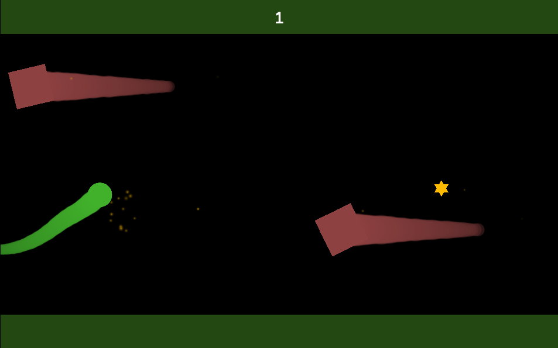

# Flappy Comet

Простая 2D-игра на Unity 6 (6000.3.8f1, Built-in RP).

**Это ветка `feature/vcontainer`: версия с внедрением зависимостей через [VContainer](https://github.com/hadashiA/VContainer).** Исходная версия без DI-фреймворка лежит в ветке [`main`](https://github.com/OCAVIT/flappy-comet/tree/main).

- **Что изменилось:** [сравнение веток](https://github.com/OCAVIT/flappy-comet/compare/main...feature/vcontainer), история по шагам в [коммитах](https://github.com/OCAVIT/flappy-comet/commits/feature/vcontainer).
- **Диаграммы зависимостей до и после:** [docs/dependencies.md](docs/dependencies.md).
- **Играть:** https://ocavit.github.io/flappy-comet/. Опубликованный билд собран из `main`, а правила игры в обеих версиях одинаковые.



## Как играть

- **Зажата ЛКМ:** комета летит вверх. **Отпущена:** летит вниз. Пробел работает так же.
- **Метеориты** — красные квадраты со следом. Каждый вылетает спереди на той высоте, где сейчас комета, и летит прямо на неё. Столкновение заканчивает игру.
- **Звёзды** дают по одному очку.
- **Зелёные полосы** сверху и снизу тоже заканчивают игру.
- Игра стартует и перезапускается новым нажатием ЛКМ или пробела.

Со временем мир ускоряется с 5 до 9 единиц в секунду, а метеориты идут чаще.

## Внедрение зависимостей

Корень композиции один: [`GameLifetimeScope`](Assets/_Source/GameSystem/GameLifetimeScope.cs). Здесь видно, из чего собрана игра:

```csharp
protected override void Configure(IContainerBuilder builder)
{
    builder.RegisterInstance(settings.flow);
    builder.RegisterInstance(settings.world);
    builder.RegisterInstance(settings.flight);
    builder.RegisterInstance(settings.spawn);

    builder.Register<IFlightInput, MouseAndSpaceFlightInput>(Lifetime.Singleton);
    builder.Register<IGameClock, UnityGameClock>(Lifetime.Singleton);
    builder.Register<GameSession>(Lifetime.Singleton).AsSelf().As<IGameSession>();
    builder.Register<WorldSpeed>(Lifetime.Singleton).AsSelf().As<IWorldSpeed>();

    builder.Register<IPlayField, CameraPlayField>(Lifetime.Singleton).WithParameter(gameCamera);
    builder.Register<IObstacleFactory, ObstacleFactory>(Lifetime.Singleton)
        .WithParameter(meteorPrefab)
        .WithParameter(starPrefab);

    builder.RegisterComponent(comet).As<IComet>();
    builder.RegisterComponent(sparks).As<ISparks>();
    builder.RegisterComponent(hud).As<IGameHudView>();

    builder.RegisterEntryPoint<GameFlow>();
    builder.RegisterEntryPoint<ObstacleSpawner>();
    builder.RegisterEntryPoint<GameHudPresenter>();
}
```

- **Правила игры** живут в обычных C#-классах без `MonoBehaviour`. `GameFlow`, `ObstacleSpawner` и `GameHudPresenter` — точки входа, их вызывает сам VContainer.
- **`MonoBehaviour` остались только у видимых объектов:** комета, метеориты, звёзды, искры, тексты на экране.
- **Префабы** создаёт `ObstacleFactory` через контейнер, поэтому зависимости приходят в них сами.
- **Баланс игры** собран в одном ассете: `Assets/_Presentation/Settings/GameSettings.asset`.
- **Другого DI-фреймворка в проекте нет,** VContainer подключён через UPM, версия 1.19.0 закреплена тегом.

## Устройство проекта

Папки по правилам команды: всё нарисованное и собранное в `_Presentation`, весь код в `_Source`, пространства имён вида `XxxSystem`.

```
Assets/
  _Presentation/   Сцена Game, настройки GameSettings, префабы Meteor и Star, спрайты, материалы частиц
  _Source/
    GameSystem/    GameLifetimeScope, GameFlow, GameSession, GameSettings
    WorldSystem/   WorldSpeed (скорость мира), GameClock (время)
    CometSystem/   Comet (полёт, след, столкновения), IFlightInput (ввод)
    SpawnSystem/   ObstacleSpawner, ObstacleFactory, PlayField, Meteor, Star, Scroller, Hazard, SparkField
    UISystem/      GameHudPresenter, GameHudView
    Editor/        GameBuilder: собирает спрайты, префабы, сцену и WebGL-билд из кода
    Tests/         EditMode (правила без сцены) и PlayMode (настоящая сцена)
  WebGLTemplates/  Страница игры: экран 16:10 на всё окно и индикатор загрузки
```

## Сборка

В редакторе: меню **Flappy Comet → Build WebGL**. Билд появится в `Builds/WebGL`.

Без открытия редактора:

```bat
Unity.exe -batchmode -quit -projectPath . -buildTarget WebGL -executeMethod BuildSystem.GameBuilder.BuildWebGL
```

Пункт **Flappy Comet → Rebuild Scene and Prefabs** пересоздаёт спрайты, префабы и сцену. Ассет настроек при этом сохраняет значения.

## Тесты

Запуск: Window → General → Test Runner.

**EditMode, 25 тестов, все вместе примерно 0,1 секунды.** Правила на подставных зависимостях, без сцены и ожидания:

- ход игры: старт, очки, столкновение, защита от случайного перезапуска;
- рост скорости мира;
- появление препятствий: высота, частота, сброс при новой игре;
- что показывает HUD.

**PlayMode, 9 тестов на настоящей сцене.** Настоящие и контейнер, и физика, подменён только ввод:

- удержание ведёт вверх, отпускание вниз;
- метеорит вылетает спереди на высоте кометы, летит прямо, быстрее мира и оставляет след;
- звезда даёт одно очко и исчезает;
- метеорит и обе полосы заканчивают игру;
- новое нажатие начинает игру заново;
- автопилот доходит до максимальной скорости и собирает звёзды, то есть игра проходима.
