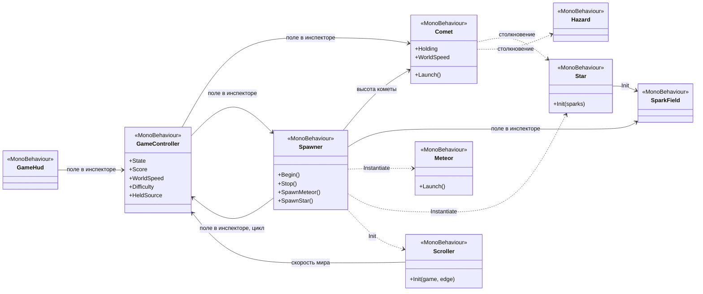
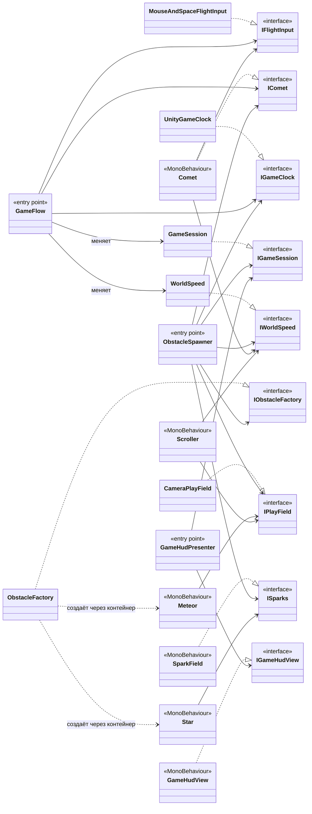

# Зависимости проекта: до и после VContainer

В исходной версии DI-фреймворка не было, поэтому VContainer внедрён с нуля. Других контейнеров в проекте нет: в `Packages/manifest.json` только VContainer, единственный контейнер собирает `GameLifetimeScope`.

## До: ветка `main`

Объекты связаны ссылками в инспекторе (их расставляет `GameBuilder`) и ручными вызовами `Init`.

## После: ветка `feature/vcontainer`

Классы знают только интерфейсы, а связывает их контейнер. Зависимость направлена в одну сторону, циклов нет: VContainer проверяет это при сборке контейнера. Классы без пометки — обычные C#-классы без `MonoBehaviour`.

### Что зарегистрировано в контейнере

Всё находится в одном месте: [`GameLifetimeScope.Configure`](../Assets/_Source/GameSystem/GameLifetimeScope.cs).

| Что | Как | Кому нужно |
|---|---|---|
| `FlowSettings`, `WorldSettings`, `FlightSettings`, `SpawnSettings` | `RegisterInstance`, части ассета `GameSettings` | Каждому классу только его часть |
| `IFlightInput` → `MouseAndSpaceFlightInput` | `Register`, Singleton | `GameFlow`, `Comet` |
| `IGameClock` → `UnityGameClock` | `Register`, Singleton | `GameFlow`, `ObstacleSpawner` |
| `GameSession` и `IGameSession` | `Register`, Singleton | Меняет `GameFlow`, остальные только читают |
| `WorldSpeed` и `IWorldSpeed` | `Register`, Singleton | Меняет `GameFlow`, остальные только читают |
| `IPlayField` → `CameraPlayField` | `Register`, Singleton, камера через `WithParameter` | `ObstacleSpawner`, `Meteor`, `Scroller` |
| `IObstacleFactory` → `ObstacleFactory` | `Register`, Singleton, префабы через `WithParameter` | `ObstacleSpawner`, тесты |
| `IComet` → `Comet`, `ISparks` → `SparkField`, `IGameHudView` → `GameHudView` | `RegisterComponent`, объекты сцены | `GameFlow`, `ObstacleSpawner`, `Star`, `GameHudPresenter` |
| `GameFlow`, `ObstacleSpawner`, `GameHudPresenter` | `RegisterEntryPoint` | Их вызывает сам VContainer: `Initialize`, `Tick`, `Dispose` |

Экземпляры префабов `Meteor` и `Star` не регистрируются: `ObstacleFactory` создаёт их через `IObjectResolver.Instantiate`, и контейнер сам вызывает их методы `[Inject] Construct`.

## Что изменилось

| Было | Стало |
|---|---|
| Цикл `GameController` ⇄ `Spawner` | Цикла нет: спаунер подписан на события `IGameSession` |
| `GameController` делал всё: ввод, состояние, счёт, скорость мира, заморозку времени | `GameFlow` (правила), `GameSession` (состояние и счёт), `WorldSpeed` (скорость), `IFlightInput` (ввод), `IGameClock` (время) |
| Скрытые статические `Input`, `Time.timeScale`, `Camera.main` | За интерфейсами `IFlightInput`, `IGameClock`, `IPlayField`: зависимости видны в конструкторе |
| `Spawner` вызывал `Scroller.Init` и `Star.Init` и знал, что нужно чужим классам | Префабы получают зависимости сами через `[Inject]` |
| Правила можно было проверить только на загруженной сцене | 25 EditMode-тестов на подставных зависимостях, все проходят примерно за 0,1 секунды |
| Лазейка `GameController.HeldSource` для тестов | Удалена: тест подменяет `IFlightInput` через `LifetimeScope.Enqueue`, код игры об этом не знает |
| Числа баланса в полях разных `MonoBehaviour` | Один ассет `GameSettings` |
| Ссылки между объектами в инспекторе | Ссылки только у корня композиции: настройки, камера, объекты сцены и префабы |

Что осталось как есть, и почему:

- `Time.deltaTime` в `Comet`, `Meteor`, `Scroller` и `Star`. Это обычный кадровый цикл видимых объектов, правил там нет.
- `Random` в `ObstacleSpawner`. Тесты задают настройки так, чтобы случайность не влияла на результат.
- `sizeRange`, `spinRange` у `Meteor` и `sparkInterval` у `Star`. Это свойства самих префабов, а не баланс всей игры.
- Генератор кода VContainer не подключён: контейнер собирается один раз на сцену, а объектов создаётся всего несколько в секунду, так что выигрыша не будет.

## Сборка WebGL и обрезка кода

В WebGL-билде включена сильная обрезка кода (Managed Stripping Level: High), а VContainer находит конструкторы через рефлексию. Поэтому у всех классов, которые создаёт контейнер, конструктор помечен `[Inject]`, даже если он пустой: в VContainer этот атрибут наследует `PreserveAttribute`, который просит сборщик не удалять код. Внедрение проверено в настоящем WebGL-билде: игра запускается, управление, счёт, столкновения и перезапуск работают, ошибок в консоли нет.
